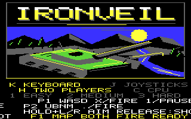
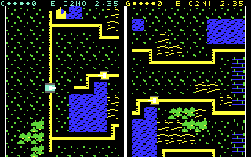
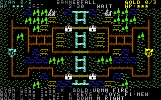
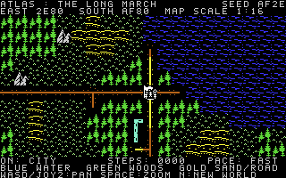
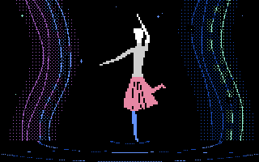

# C64 experiments

## Development references

- [Game design principles](GAME_DESIGN_PRINCIPLES.md): researched guidance on
  controls, decisions, balance, AI, maps, presentation, accessibility, and
  playtesting, with practical C64 examples and review checklists.
- [C64 tips and tricks](TIPS_AND_TRICKS.md): hardware behavior, implementation
  techniques, tooling, and distribution guidance.

## Borrowed Motion

An original single-player puzzle game about treating **movement as an object**.
Borrow the motion of brass bells, lend it to luminous pearls, and recover it
when they reach their nests. Ten authored rooms introduce reflections, mirrors,
different speeds, and exchanges made halfway through a journey. You control
when the world advances and have unlimited time to think.


**A/D** selects an artifact; **Space** exchanges its motion with your pocket.
**Tap W** for one beat or **hold W** to keep winding. **S** undoes up to 32
exchanges or beats; **R** restarts, **H** opens help, and **M** toggles sound.
A pearl completes its journey only when it is still on a nest. A full pocket
swaps motions, so it must be emptied before it can brake another pearl.

A joystick in **port 2** uses left/right to select, fire to exchange, up to
wind, and down to undo. Press **Return or fire** to begin. Restored rooms unlock
for replay during the current session.


Download the [Borrowed Motion PRG](dist/borrowed-motion.prg) or
[1541 disk image](dist/borrowed-motion.d64), or build and run with:

```sh
make motion
make run-motion
make motion-disk
make run-motion-disk
```

See [Borrowed Motion controls, rules, and hardware notes](docs/BORROWED_MOTION.md).

## Ironveil

A deliberate split-screen tank duel across an asymmetric procedural battlefield.
Drive through forests, deserts, reed banks, roads, bridges, and fords; turn the
hull to protect your armor and aim the turret independently. Camouflage, mountain
line of sight, and coarse sensor contacts make finding the opponent part of the
fight. First to three knockouts wins, with a three-minute deadline and sudden
death for ties.

Tanks start near opposite diagonal corners at tiles **(1,1)** and **(30,14)**.
Forest averages **30.46%** of audited maps, up from **6.56%**. A yellow diamond
marks the reported enemy sector; an edge arrow gives its rough bearing when
that sector is outside the view.

Play two humans locally or choose an **Easy / Medium / Hard** computer opponent.
In computer mode the right pane shows a coarse contact map, keeping hidden enemy
positions concealed. Human matches give each player a following **9×12-tile**,
144×192-pixel view of the 32×16-tile world, with one compact HUD row above the
maps. The original bitmap opening screen holds all game configuration and
control help, and returns after a match.

Two distinct low SID engines respond to actual movement and hull turns. A
moving opponent becomes louder nearby; parked tanks and turret-only aiming
stay quiet. Cannon fire, impacts, knockouts, and victory have original effects.



**Keyboard:** cyan uses **WASD** and gold uses **U/B/N/M** for map directions.
Hold a direction to turn the hull toward it, then drive; diagonals work and
opposing directions cancel on each axis. Cyan uses **Q/2 + X** for turret/fire;
gold uses **semicolon/Return + period**. **1** pauses keyboard play.

**Joysticks:** cyan uses **port 2**, gold **port 1**. Up/down drive
forward/reverse and left/right turn the hull;
hold the button and move left/right to aim, then release the button to fire.

Choose **K/J** for keyboard/joysticks, **H/C** for human/computer, or
**1/2/3** for Easy/Medium/Hard on the title or result screen. **F1** creates a
new map from setup or while paused with gameplay controls released. Both humans
ready with fire; only cyan needs to ready against the CPU.
On joysticks, press and release the button to ready.



Download the prebuilt [Ironveil PRG](dist/ironveil.prg) or
[1541 disk image](dist/ironveil.d64), or build and run with:

```sh
make tanks
make run-tanks
make tanks-disk
make run-tanks-disk
```

See [Ironveil controls, tactics, and hardware notes](docs/IRONVEIL.md).

## Bannerfall

A capture-the-flag game across a fresh procedural battlefield. Play locally
against another person or command cyan against a computer-controlled gold army.
Guide cyan and gold armies through forests, deserts, cities, fords, roads, and
bridges. Mountains block movement and shots; fast roads reward bold raids,
while slower river crossings offer flanking routes. Mirrored geography gives
both players equal starting terrain.

Steal the enemy flag and bring it home while your own flag is safe. First to
three captures wins; a tied 2:30 match enters sudden death. Any hit drops a
carried flag, and a defeated army quickly respawns for another attempt.

**Shared keyboard:** player 1 uses **WASD + X**; player 2 uses
**U/B/N/M + period** (up/left/down/right + fire).
**Two joysticks:** player 1 uses **port 2**, player 2 **port 1**.
Choose **K** for keyboard or **J** for joysticks on the title or result screen.
**H** selects two humans (the default); **C** selects the computer opponent.
Two human players each press fire to ready. The computer readies automatically,
so player 1 presses fire to start a solo match. Player 1 uses joystick port 2
in either opponent mode. Opponent choice persists across new fields and rematches.
Release gameplay controls to choose a mode or use **F1** for a new field.
**RUN/STOP** pauses (**Escape** in macOS VICE); **Return** also pauses in
keyboard mode.



Download the prebuilt [Bannerfall PRG](dist/bannerfall.prg) or
[1541 disk image](dist/bannerfall.d64), or build and run with:

```sh
make duel
make run-duel
make duel-disk        # build/bannerfall.d64
make run-duel-disk
```

See [Bannerfall rules and hardware notes](docs/BANNERFALL.md) for movement costs,
controls, generation, audio, and compatibility status.

## Atlas: The Long March

A procedural world of water, forests, deserts, mountains, winding rivers,
cities, roads, and bridges. Move an army through the landscape; terrain changes
travel speed and water blocks movement. The world is 65,536 × 65,536 tiles and
wraps at its edges. Geography is generated on the C64 as needed, with no disk
streaming or memory expansion.

**Controls:** WASD or IJKL, C64 cursor keys, or a joystick in port 2. Space/fire
cycles seven zoom levels (1, 4, 16, 64, 256, 1,024 and 4,096 tiles per displayed
cell). Directions pan the overview while zoomed out; the army stays in place.
Cycling back to the close view returns to the army. N generates a new world.



Download the prebuilt [Atlas PRG](dist/atlas.prg) or [1541 disk image](dist/atlas.d64),
or build and run with:

```sh
make atlas
make run-atlas
make atlas-disk       # build/atlas.d64
make run-atlas-disk
```

See [Atlas design and hardware notes](docs/ATLAS.md) for terrain costs,
procedural generation and compatibility results.

## Nocturne

An original dance animation for a stock Commodore 64: a luminous ballet figure,
lavender and cyan curtains of light, twinkling motes, water glints, and a gentle
three-voice SID score. It loops without text or user controls.

The dancer has 96 original poses in eight expanded hires sprites. XOR/RLE frame
compression, two sprite buffers, and a raster-driven scheduler keep animation,
lighting, and music coordinated. PAL, common NTSC and old NTSC are detected at
startup; simulation rate and SID pitch are adjusted separately.



## Build and run

Download the prebuilt [Nocturne PRG](dist/nocturne.prg) to run it without building.

With Python 3, `cc65` (ca65/ld65) and VICE installed:

```sh
make all
make run
```

`make all` builds Borrowed Motion, Ironveil, Bannerfall, Atlas, and Nocturne;
`make run` launches Nocturne.
The Nocturne output is `build/nocturne.prg`. The build regenerates the original graphics
using Python's standard library; it needs no downloaded art or Python packages.
On macOS the launch helper supplies the native app context needed by GTK VICE.
Generated launchers and emulator logs stay under `build/dance/`.

To create a standard 1541 disk image, run `make disk`; `make run-disk` exercises
that image with true drive emulation and device-8 loading traps disabled.
On a physical C64, transfer the PRG to a supported storage device, or write the
generated D64 to a disk, then use `LOAD"NOCTURNE",8,1` followed by `RUN`.

See [the implementation and hardware notes](docs/NOCTURNE.md) for the memory map,
compatibility scope and verification record. Physical hardware testing remains
to be done when a C64 is available.

## Original proof of concept

The earlier border-animation demo remains in `src/demo.s`. Build it with
`make demo` and launch it with `make run-demo`.

## Game development reference

See [TIPS_AND_TRICKS.md](TIPS_AND_TRICKS.md) for researched guidance on C64
graphics, memory, interrupts, game architecture, input, audio, and debugging.
