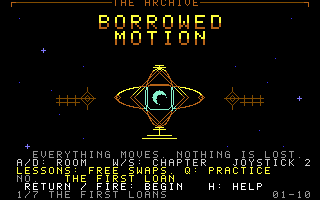
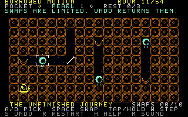

# Borrowed Motion

A single-player puzzle game for an unexpanded Commodore 64. You are the keeper
of a celestial archive where movement can be borrowed, stored, and given away.
Recover the motion of brass bells, lend it to luminous pearls, and bring every
pearl to rest in a golden nest.

The campaign has **64 rooms**: the original ten lessons and 54 further rooms
designed for more demanding planning across six chapters. There is no deadline:
the world advances only when you
choose to step forward. Take as long as you like to inspect a room and plan the
next exchange.

**Returning after room 10? On the opening title, press W once, then Return.**
That selects room 11, *The Unfinished Journey*. Every room is available from the
title, including after closing and reopening the game.



## Play

Select an artifact with **A/D**. Your pocket holds one movement (direction
and speed), and **Space** trades its contents with the selected artifact.

- An **empty pocket** takes an artifact's motion and leaves it still.
- A **full pocket** gives its motion to the artifact and receives the artifact's
  previous motion. It only stops the artifact if the pocket was empty.
- **Tap W: one step; hold W: keep stepping.** Each step advances the whole room
  together. Objects with motion follow their arrows; fast motion can cover two
  tiles per step. Release the key to stop after the current step.
- A pearl settles when it is **still on an unused golden nest**. Passing over
  a nest is not enough. Take its motion back when it arrives.

In the first room, take the bell's eastward motion, select the pearl, and lend it
that motion. Take five steps to reach the nest, then take the motion back. The
empty cradle blossoms when the pearl settles. Later rooms ask you to find useful
places for displaced motion and change a journey partway through.

Bells can store motion throughout a room. A settled pearl cannot be selected
again. Artifacts pass through one another, and all nests accept any pearl.
Selection works across the whole room, including separate display areas.



## Controls

Use the keyboard, a joystick in **port 2**, or both. A/D and joystick left/right
cycle through artifacts; they do not steer an artifact directly.

| Action | Keyboard | Joystick port 2 |
|---|---|---|
| Select previous / next artifact | A / D | Left / right |
| Exchange selected artifact's motion | Space | Fire |
| Advance one step / keep stepping | Tap / hold W | Tap / hold up |
| Undo | S | Down |
| Start or continue to the next room | Return or Space | Fire |
| Restart the current room | R | Use keyboard |
| Open help | H | Use keyboard |
| Toggle sound | M | Use keyboard |
| Return to the title | RUN/STOP; normally Escape in macOS VICE | Use keyboard |
| Choose a room on the title | A / D | Left / right |
| Choose a chapter on the title | W / S | Up / down |
| Toggle Challenge / Practice on the title | Q | Use keyboard |

Release gameplay controls before using H, M, Q, Return, or RUN/STOP. **R also works
while W alone is held**, and from the in-game help screen. After restarting,
release R and the gameplay controls before acting again. This keeps a held
direction from immediately moving the freshly restored objects. Larger keyboard
chords are ignored for restart because the C64 matrix can falsely report R.

Restart restores every artifact's original position and movement, empties your
pocket, reopens all nests, clears the swap/step counters and undo history, and
discards any queued action or unfinished animation. All rooms remain
available. Some rooms begin with movement already assigned to their objects;
those original arrows are restored too.

Undo remembers the last **64 actions (exchanges or steps)** in the current room;
hold S/down to undo repeatedly. You can undo the final exchange after a room
is complete. Starting the next room or restarting clears that room's undo
history. Restarting is always available if you want a fresh attempt.

On the title screen, A/D or left/right chooses any room. W/S or up/down selects
the next/previous chapter. The game does not write a save file; remember the room
number to resume next time. Challenge / Practice resets to Challenge on a fresh
launch.

## The harder chapters

Rooms 1–10 retain unrestricted exchanges. In **Challenge**, rooms 11–64 have a
limited number of exchanges, displayed on the title and as **SWAPS used/limit**
beside the room name. Restore all pearls within the allowance. An exchange between
identical motions does nothing and costs nothing.

Selecting artifacts, thinking and stepping are free. **Undoing an exchange
refunds it**; undoing a step reverses only that step. Restart restores the full
allowance. If you run out, the game
explains how to undo or restart; it does not force a reset or discard your work.
You can still inspect and step the room.

Press **Q on the title** for **Practice**, which removes the allowance from
every room. Changing mode then beginning a room starts it fresh. The first new
chapter gives one extra exchange beyond its authored solution; later allowances
ask for more economical routes. An allowance is a known achievable target,
not a claim that there is only one solution or that the target is optimal.

The new puzzles ask you to keep useful pearls unfinished, prepare several
positions before changing the available direction, capture a passing heading,
and reuse an arrival to turn another journey. Moving one pearl at a time is
still possible in many rooms, but its extra storage exchanges can exceed the
allowance.

| Chapter | Rooms | Title |
|---|---|---|
| 1 | 1–10 | The First Loans |
| 2 | 11–19 | The Deeper Shelves |
| 3 | 20–28 | The Quiet Machines |
| 4 | 29–37 | The Mirror Vaults |
| 5 | 38–46 | The Inner Archive |
| 6 | 47–55 | The Constellations |
| 7 | 56–64 | The Heart of Motion |

## Reading the room

**Cyan pearls** belong in nests. **Brass bells** supply or hold motion. White
corner brackets identify the selected artifact. The HUD shows the motion in
your **POCKET**, the selected artifact and its motion, and how many pearls
**REST**. **SWAPS** counts exchanges; stepping does not increase that count.

Each artifact has a direction marker. A **2 beside a HUD arrow** identifies
fast motion. The **purple ghost** predicts the selected artifact's position
after the next complete step, including reflections, mirrors, and slowing glass.
It is a preview, not another artifact or a destination to collect.

| Object or surface | Effect |
|---|---|
| Ordinary motion | Attempts one tile per step |
| Fast motion | Attempts two consecutive tile moves per step |
| Wall or room edge | Reverses direction; that tile attempt is used without entering the wall |
| Slash or backslash mirror | Turns motion on entry; preserves speed |
| Hourglass-shaped soft glass | Reduces fast motion to ordinary speed and ends the current step there |
| Empty golden nest | Accepts a stationary pearl |
| Filled star-shaped nest | Already restored; remains passable |

Fast motion completes both tile attempts before another exchange. A wall
reversal can therefore be followed by a move in the opposite direction during
the same step. Use the ghost to inspect the result before stepping. You can
stop and think between steps without losing anything.

## The original ten lessons

| Room | Name | Main idea |
|---|---|---|
| 1 | The First Loan | Take, lend, step, and recover motion |
| 2 | A Change of Heart | Exchange with a full pocket |
| 3 | The Patient Wall | Find a useful reflection |
| 4 | An Unexpected Turn | Turn a journey with a mirror |
| 5 | Pass It On | Reuse motion after a delivery |
| 6 | A Place for Everything | Store displaced motion |
| 7 | Long Strides | Work with fast motion |
| 8 | The Soft Glass | Slow a journey |
| 9 | The Quiet Exchange | Change a journey partway through |
| 10 | Borrowed Tomorrow | Coordinate different journeys and arrival times |

Any sequence that restores every pearl within the room's allowance completes
it. There is no required command sequence or hidden timer. Practice permits
unlimited exchanges in every room.

## Download and build

The release includes a PRG and a standard 1541 disk image:

- [Borrowed Motion PRG](../dist/borrowed-motion.prg)
- [Borrowed Motion D64](../dist/borrowed-motion.d64)

Build with Python 3 and cc65's `ca65`/`ld65`; VICE supplies `x64sc` and `c1541`:

```sh
make motion
make motion-disk
make run-motion
make run-motion-disk
```

The PRG launcher uses direct RAM autostart. The disk launcher uses true 1541
emulation with device-8 loading traps disabled. The disk's program name is
`borrowed-motion`. On a physical C64, transfer the PRG to compatible storage or
write the D64 to a disk, then enter:

```text
LOAD"BORROWED-MOTION",8,1
RUN
```

Game code is in [`src/motion/`](../src/motion/). Original character and sprite
art comes from [`generate_motion_assets.py`](../tools/generate_motion_assets.py).
The independent rules model and original lessons are in
[`generate_motion_levels.py`](../tools/generate_motion_levels.py); the expansion
is authored in [`motion_chapter_middle.py`](../tools/motion_chapter_middle.py),
[`motion_chapter_expert.py`](../tools/motion_chapter_expert.py), and
[`motion_chapter_finale.py`](../tools/motion_chapter_finale.py). The generators
use Python's standard library and preserve reproducible source assets. Detailed
room rationale and reference solutions are in
[the level design notes](MOTION_LEVEL_DESIGN.md).

## Hardware and verification

The game targets a stock C64 with ordinary hires character graphics, eight
hardware sprites, and SID sound. It detects PAL, common NTSC, and old NTSC and
normalizes gameplay timing. The board fits on one screen; no memory expansion
or cartridge is required. The 64-room PRG is **27,721 bytes**. All rooms load at
once; there is no disk loading between them. Packed maps use 5,184 bytes total,
and the 64-action undo buffer occupies 4 KiB of ordinary RAM.

VICE checks of the original release, commit **`18b6a3f`**, covered **PAL
with a 6581**, **NTSC with an 8580**, and **old NTSC with a 6581**. Each
configuration completed all ten authored solutions, undo
checks, and 60 movement-rule cases. Regional pacing was checked explicitly on
NTSC and old NTSC. These checks establish agreement with the independent rules
model and the tested emulator configurations. The ten-room release with the
restart fix and **pocket / step** terminology, **`66e0d34`**, repeated the full
suite on all three video standards, including their timing checks.

That ten-room release's focused restart suite additionally passed **78 restart
comparisons and five menu-decoding cases per video standard**. It compares all
ten rooms' logical
state, visible screen and Color RAM, and enabled sprite positions with a fresh
room. Cases cover moved objects, a full pocket, completed deliveries, unfinished
animation, queued exchanges, room completion, and help. Room 6 also exercises
R+W, held controls after restart, and two keyboard combinations that would
otherwise generate a phantom R. These matrix cases inject modeled scan results
before the real menu decoder; they are not a physical keyboard test.

The ten-room release's D64 also cold-loaded with true 1541 emulation and
device-8 loading traps disabled. Its loaded PRG matched that release file byte
for byte. The regression tool is
[`verify_motion_restart.py`](../tools/verify_motion_restart.py); use a separate
disposable VICE instance as described in its header.

Those emulator results concern the ten-room releases, not the 64-room expansion.
The expansion's normal content build replays every authored solution against
the rules model and checks its allowance. The 64-room PRG was assembled, opened
in PAL/6581 VICE, and its title and room 11 were captured for this guide. The
emulator regression tools have
been adapted for the longer campaign and history; they have not been rerun for
this expansion.

The gameplay checks injected normalized controls into the compiled input path;
they did not exercise a physical keyboard or joystick. A native macOS
accessibility timeout prevented the planned keyboard check. Screenshots were
inspected in VICE, but audible playback and a physical C64 run have not been
verified. Human play is still needed to assess understanding, enjoyment, and
puzzle difficulty.
